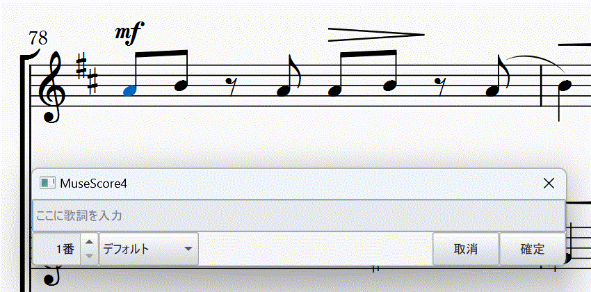
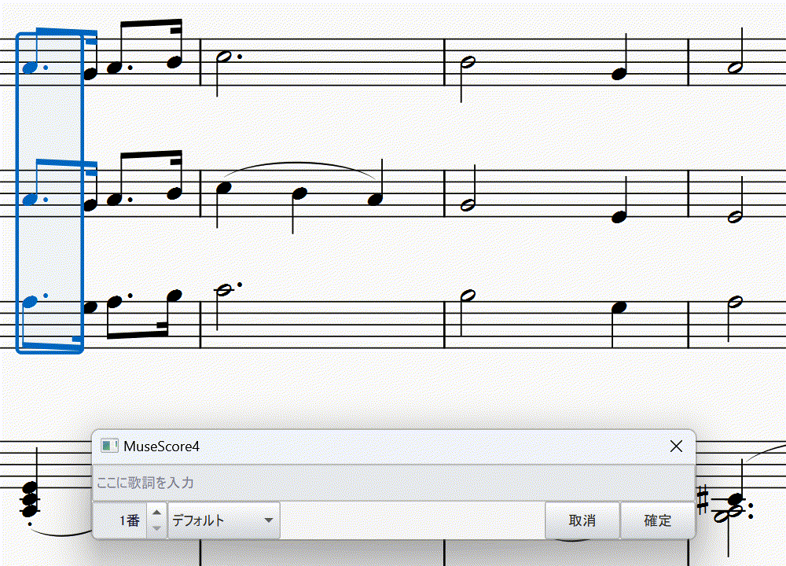

# 日本語歌詞入力 for MuseScore Studio

MuseScore Studio で日本語の歌詞入力作業を効率化するためのプラグインです。

## 注意事項
- MuseScore Studio 4.7.7 で動作を確認しています。これより古いバージョンはサポート対象外となります。
- 念のため、使用前に楽譜ファイルを保存してバックアップを取ることをおすすめします。万が一不具合によりデータが破損・消失した場合でも、制作者は一切の責任を負いません。

## インストール
1. [最新版をダウンロード](https://github.com/bakajikara/mss-jp-lyrics/archive/refs/heads/main.zip)します。
2. ダウンロードしたファイルを展開し、MuseScore Studio の Plugins フォルダに配置します。
3. MuseScore Studio の **ホーム → プラグイン** から **日本語歌詞入力** を有効化します。

## 使い方
### 起動
上部のメニューから **プラグイン → 歌詞 → 日本語歌詞入力** を選択すると、プラグインが起動します。

### 歌詞の入力
1. 歌詞入力を開始する音符を選択します。
2. 歌詞番号と歌詞の位置を選択します。
3. 入力欄に歌詞を入力します。
4. **確定** ボタンを押すと歌詞が入力され、次の音符へ移動します。

### 入力テクニック
#### 歌詞の結合・分割
標準的な結合・分割のルールが設定されていますが、このルールを手動で上書きできます。
- 通常は分割される歌詞を結合して1つの音符に入力したい場合は、歌詞の間に `+` を入力します。

- 通常は結合される歌詞を分割して2つの音符に分けたい場合は、歌詞の間にスペースを入力します。

#### 複数同時入力
複数の要素を同時に選択して入力すると、選択したすべての要素に同じ歌詞を一括で入力できます。

#### スマート音引き
音引きの代わりに `=` を入力すると、スラーまたはタイが終了する音符まで自動で音引きが入力されます。

